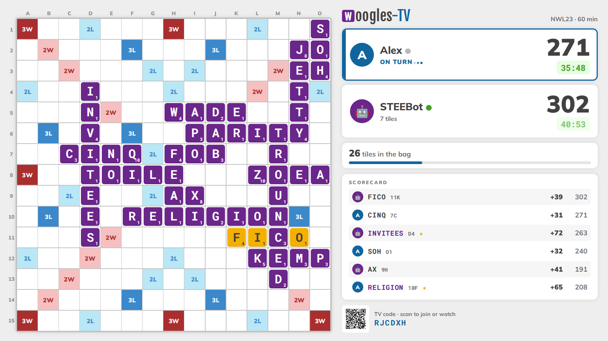
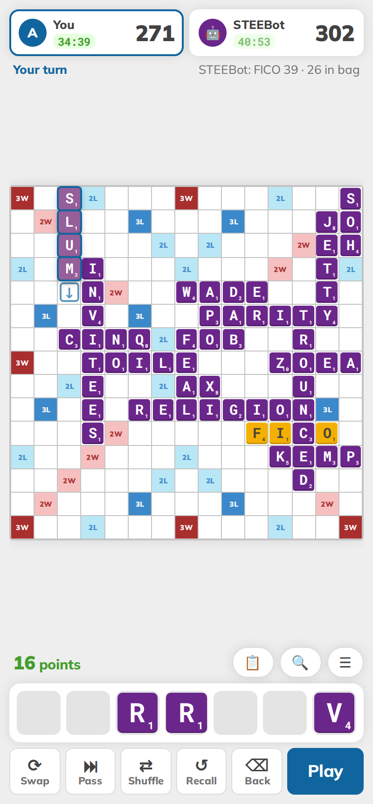
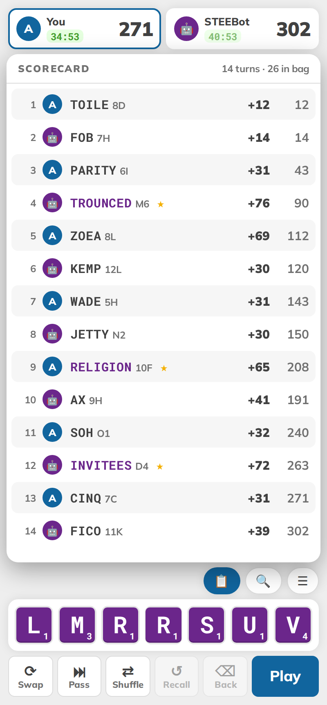
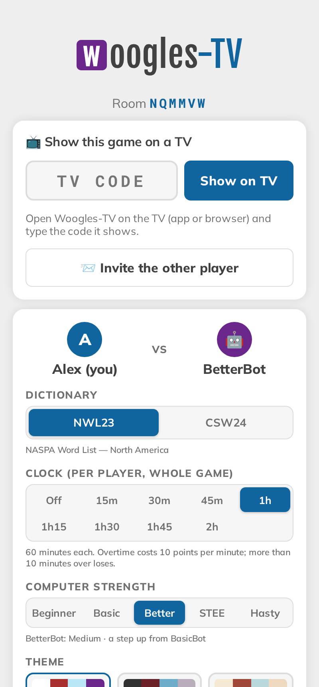
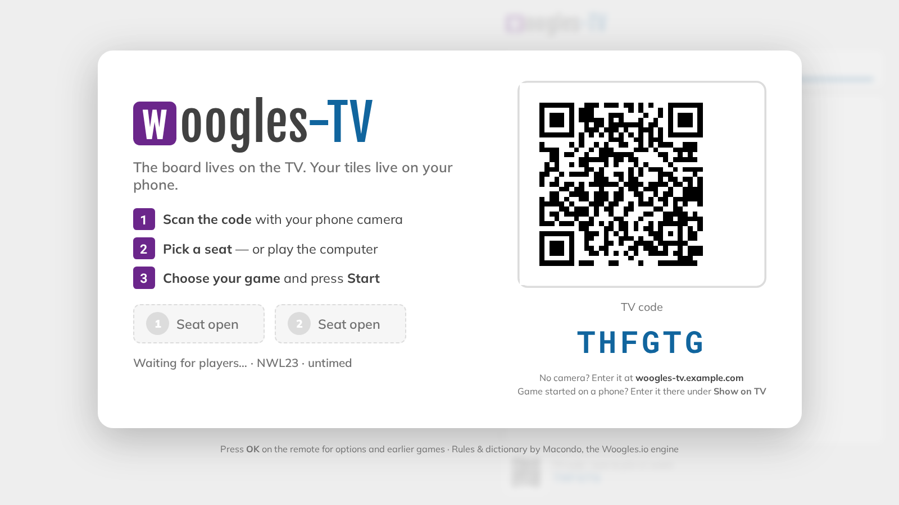
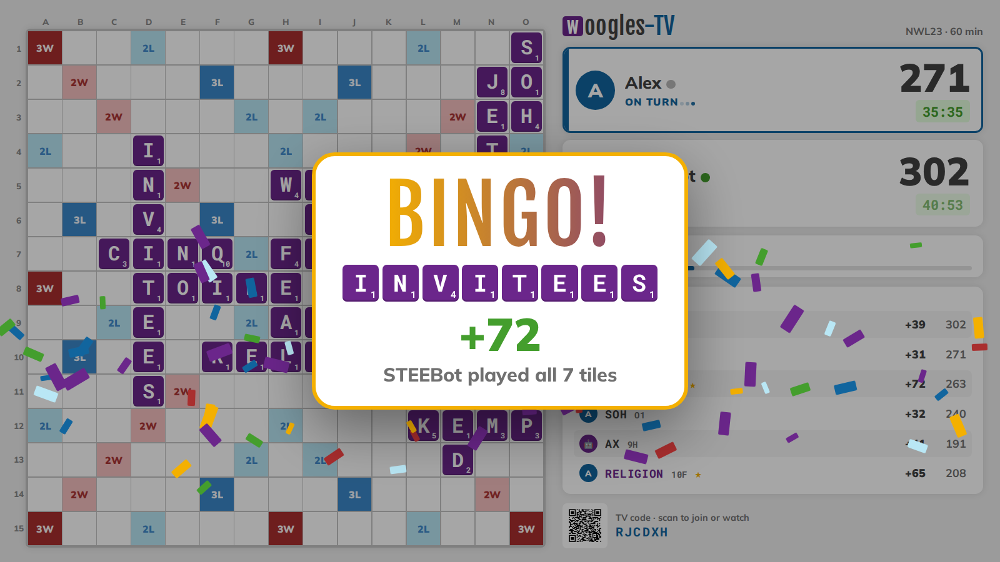
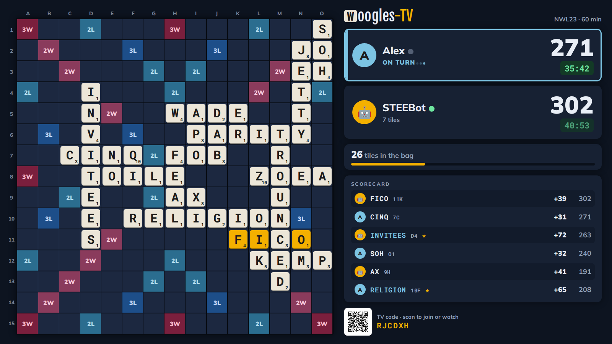
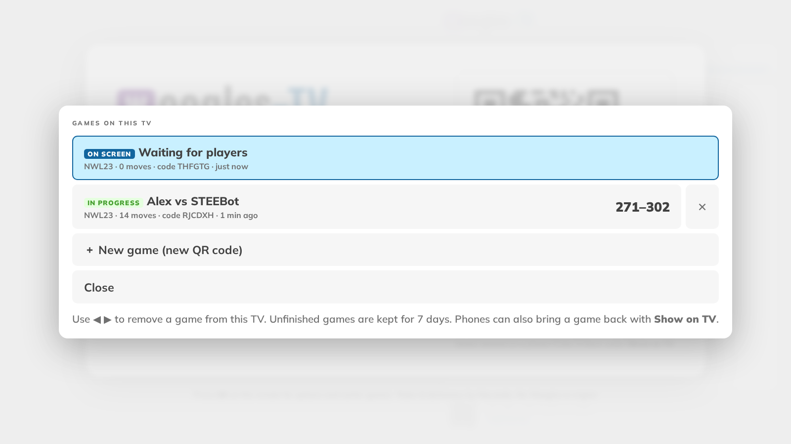

# Woogles-TV

**A living-room crossword board game: the board is on your TV, your tiles are on your phone.**

Woogles-TV puts a full-size, tournament-rules crossword board on any TV (an Android TV / Google TV app, Chromecast,
or just a browser) while each player holds a private rack on their phone. Play a friend on the couch, or take on
the computer. Rules, scoring, the NWL23 and CSW24 dictionaries and the computer opponents all come from
[Macondo](https://github.com/domino14/macondo), the engine behind [Woogles.io](https://woogles.io), and the look
follows Woogles.io too.

It's a single Go binary with the web app built in. Run it on a $5 VPS, in Docker, or on a Raspberry Pi in the
closet.



<p align="center">
  
  
  
</p>

## Features

**At the TV**
- A big, readable 15×15 board with coordinates, the last move highlighted, tiles that drop in, and score pop-ups.
- Player cards with scores, the player on turn, an optional chess clock, tiles left in the bag, and a running scorecard.
- Full-screen **BINGO!** celebration with confetti and a fanfare.
- **Spoken announcer**: "Bingo! Alex plays QUIXOTIC… for 98 points", lead changes, the bag running low, clock warnings and the result, with a choice of voice, speed and spelling words out.
- Clock warnings: chimes at 5 and 1 minute left, a 10-second countdown, and an alarm plus penalty tones in overtime.
- Driven entirely by the TV remote (D-pad + OK): theme, volume, announcer, **Games on this TV** (switch between games in progress), new game.
- Your tiles never appear on the TV; only submitted moves do.

**On your phone** (any modern browser; installable as an app/PWA)
- Tap a square (tap again to flip → / ↓), then tap tiles to type them in, or drag tiles onto the board.
- **⌫ Back** takes back the last tile; **Recall** clears the board and returns the cursor to where you started.
- **Drag tiles along your rack to rearrange them** (the others slide aside), or **Shuffle**.
- A live score of your tentative move, visible only to you. Invalid words are rejected before they're played.
- **Double-tap a word in the scorecard to hear what it means**, read by the TV's announcer (or your phone's), with the definition shown on screen.
- 📋 scorecard overlay, 🔍 board zoom, unseen tiles (bag + opponent), swap, pass, blanks, pause, resign, rematch.
- Phones, tall phones, **tablets** and landscape: the layout adapts (in landscape the board sits beside a full scorecard; tall screens show the latest moves under the board).
- Sound & voice settings per phone: volume, clock warnings for your own clock (with vibration), and an optional announcer for games without a TV.
- *Your games*: every game on this phone with live status (Your turn / In progress / Finished), a filter, and removal.
- Join as a spectator: anyone with the link who isn't seated sees the board and scores, never the racks.

**Game rules & options**
- Dictionaries: **NWL23** (NASPA Word List 2023, default) or **CSW24** (Collins Scrabble Words 2024).
- **Void challenge**: phony words are refused with no penalty, so you just try again.
- Computer opponents from the Woogles ladder: BeginnerBot, BasicBot, **BetterBot** (default), STEEBot, HastyBot.
- Optional per-player clock for the whole game (15 min to 2 h, in 15-minute steps) with **NASPA overtime**:
  −10 points per minute or part of a minute over, and more than 10 minutes over loses the game.
- Six themes (Woogles, Woogles Dark, Balsa, Forest, Pastel, Midnight), shared by the TV and the phones.

**Getting the board on a TV: pick any**
1. **Android TV / Google TV app** (e.g. Onn 4K, Chromecast with Google TV, Shield): a tiny WebView launcher, [android/](android/README.md).
2. **Cast from Chrome on Android** to any Chromecast device. Needs a one-time Cast app ID, see [docs/CAST.md](docs/CAST.md).
3. **Any browser** on a smart TV, a laptop plugged into the TV, or a Fire TV browser: open `/tv` full-screen.

Then either scan the TV's QR code with your phones (*TV-first*), or start a game on a phone and type the TV's code
under **Show on TV** (*phone-first*).

<p align="center">
  
  
  
  
</p>

## Quick start

```sh
git clone https://github.com/jgbrwn/woogles-tv && cd woogles-tv
go build -o woogles-tv .          # Go 1.27+
./woogles-tv                      # http://localhost:8420/  (word lists download on first start, ~15 MB)
```

Open `http://<your-computer's-IP>:8420/tv` on the TV (or a second browser window), then scan the QR code with a
phone on the same network. To look around without a second person, run `./woogles-tv -demo 14`: it seeds a game
in progress against STEEBot and prints a TV link and a phone link.

**Docker:**

```sh
docker compose up -d              # builds the image (word lists included) and serves :8420
```

## Documentation

| | |
|---|---|
| [User guide](docs/USER-GUIDE.md) | How to play: starting games, phone controls, TV remote, clocks, bots, several games per TV |
| [Deployment](docs/DEPLOY.md) | Any server: binary, systemd, Docker, reverse proxies (Caddy/nginx), TLS, configuration, upgrades, backups |
| [Home network / Raspberry Pi](docs/LOCAL-NETWORK.md) | Running it on your LAN: Pi setup, addresses, local DNS, HTTPS options and caveats |
| [Android TV app](android/README.md) | Building the launcher for your own server, signing, sideloading, remote keys |
| [Google Cast](docs/CAST.md) | Registering a Cast receiver so phones can cast the board |
| [Architecture](docs/ARCHITECTURE.md) | How it works: rooms, credentials, WebSocket protocol, persistence, security model |
| [Development](docs/DEVELOPMENT.md) | Hacking on it: dev mode, demo games, tests, code tour, adding themes |
| [Roadmap](docs/ROADMAP.md) · [Contributing](CONTRIBUTING.md) · [Security](SECURITY.md) | Ideas, how to help, reporting vulnerabilities |

## Tech stack

- **Server:** Go (standard library `net/http`), [coder/websocket](https://github.com/coder/websocket),
  [Macondo](https://github.com/domino14/macondo) + [word-golib](https://github.com/domino14/word-golib) for rules,
  move validation, scoring and bots, [go-qrcode](https://github.com/skip2/go-qrcode). Rooms are kept in memory and
  saved as JSON files. No database, no external services at runtime.
- **Web:** plain HTML, CSS and ES modules, with no framework and no build step, embedded into the binary. Sounds are
  synthesized with Web Audio. The PWA has a service worker and a manifest. Fonts: Mulish, Fjalla One, Roboto Mono (self-hosted).
- **TV:** an Android WebView launcher (Java, no Gradle; `android/build.sh`), plus a Google Cast Web Receiver page.

## Live instance

The author's instance runs at **https://woogles-tv.exe.xyz/** (on [exe.dev](https://exe.dev)). Feel free to try it;
for regular use, please host your own. It's easy and cheap, see [docs/DEPLOY.md](docs/DEPLOY.md).

## Credits & license

Woogles-TV is free software under the **GNU Affero General Public License v3.0**, see [LICENSE](LICENSE). If you run a
modified version for others over a network, you must offer them its source. The links in the app footer to this
repository are one easy way to do that.

It builds on [Macondo](https://github.com/domino14/macondo) and [word-golib](https://github.com/domino14/word-golib)
(GPL-3.0) by César Del Solar and contributors, and its look is modelled on
[Woogles.io / liwords](https://github.com/woogles-io/liwords) (AGPL-3.0). Word lists are downloaded from the Woogles
repository at runtime and are not part of this repository. NWL23 is © NASPA and CSW24 is © HarperCollins; please respect
their terms. Woogles-TV is an independent project, not affiliated with or endorsed by Woogles.io, NASPA, Collins,
Hasbro or Mattel. "Scrabble" is a trademark of its owners. See [NOTICE](NOTICE) for details.
