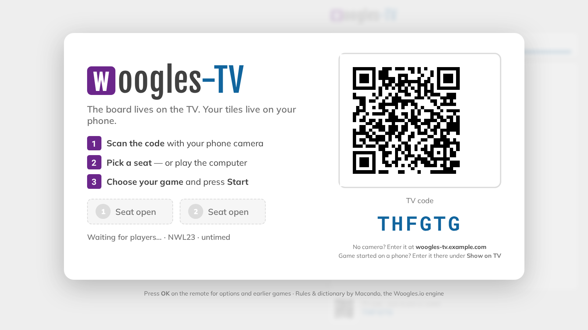
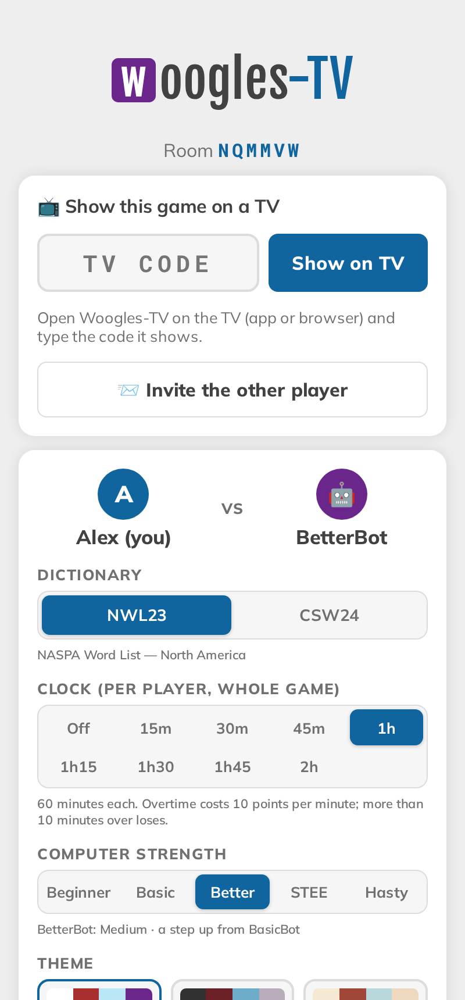
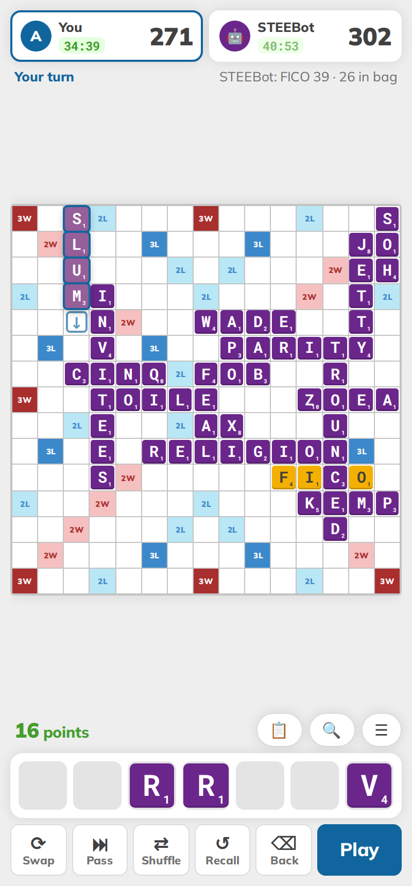
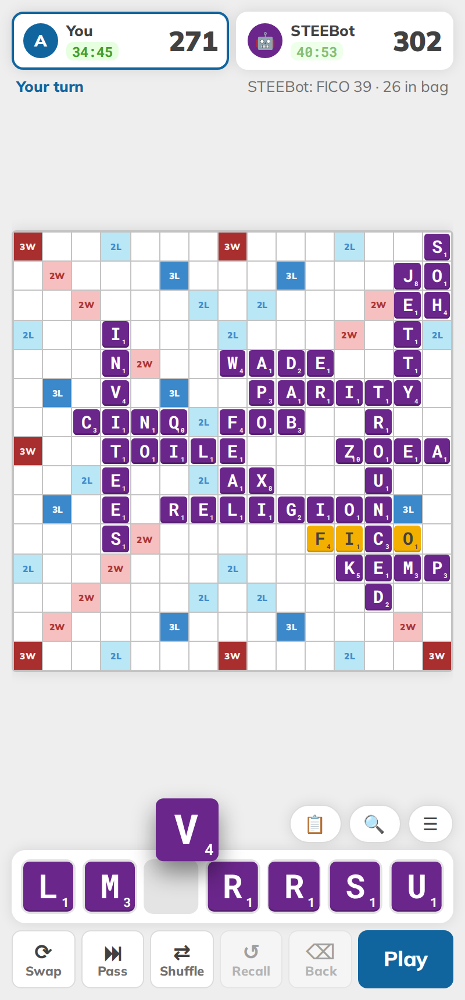
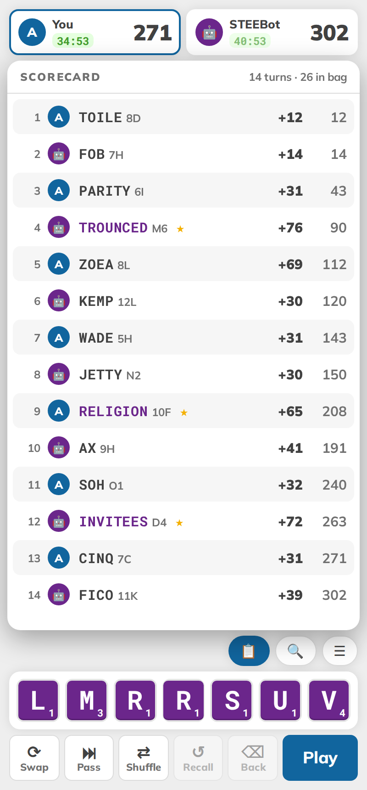
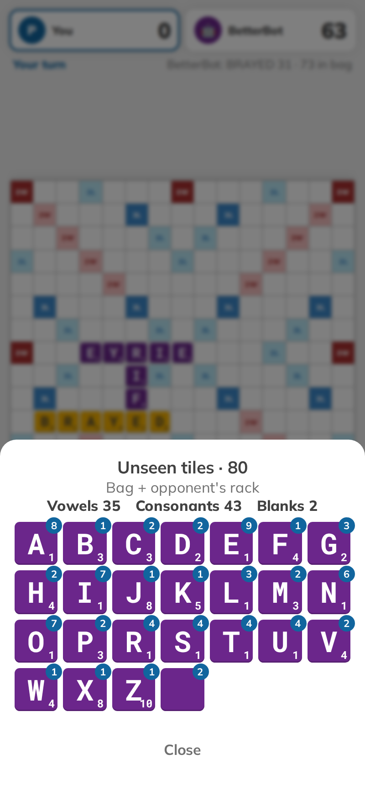
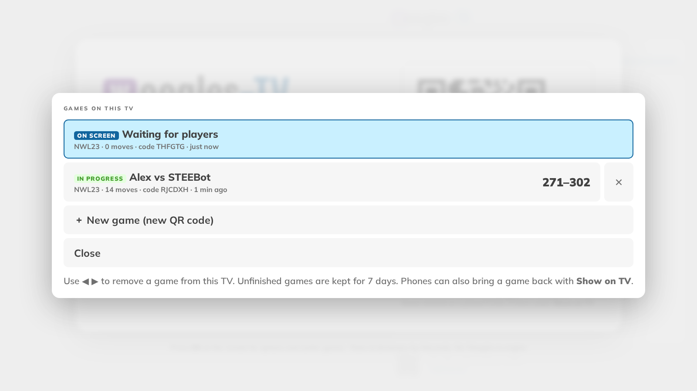
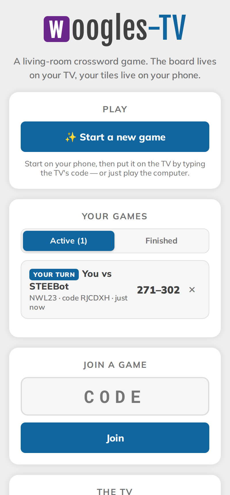

# Woogles-TV user guide

Woogles-TV is a two-player crossword board game for the living room. The **TV** shows the board, scores and clocks.
Each **phone** is a private rack and the controller. You can play another person or the computer.

- [1. Put the board on the TV](#1-put-the-board-on-the-tv)
- [2. Start a game](#2-start-a-game)
- [3. Playing on your phone](#3-playing-on-your-phone)
- [4. The TV remote](#4-the-tv-remote)
- [5. Rules, clocks and the computer](#5-rules-clocks-and-the-computer)
- [6. Several games, rejoining and watching](#6-several-games-rejoining-and-watching)
- [7. Installing the phone app (PWA)](#7-installing-the-phone-app-pwa)
- [8. Troubleshooting](#8-troubleshooting)

Throughout this guide, `https://your-server` is wherever Woogles-TV is hosted.

## 1. Put the board on the TV

Choose one of these:

| Option | What you need | How |
|---|---|---|
| **Android TV / Google TV app** | Onn 4K, Chromecast with Google TV, Shield, Sony/TCL/Hisense Google TVs… | Sideload the APK ([android/README.md](../android/README.md)), then open **Woogles-TV** from Apps |
| **Cast from a phone** | Chrome on Android plus any Chromecast device; the server owner must set it up once ([CAST.md](CAST.md)) | On the phone's home page tap **📡 Start a game & cast it to a TV**, or **☰ → Cast board to TV** in a game |
| **Any browser** | Smart TV browser, a laptop connected over HDMI, etc. | Open `https://your-server/tv` and go full-screen (F11) |

The TV lobby shows a **QR code** and a 6-letter **TV code**. The TV code is always the code of the game currently on
screen. During a game it sits in the bottom-right corner, labelled *TV code*.

The first click or key press on a browser TV turns on sound; browsers block audio until then. The Android TV app plays
sound straight away.

## 2. Start a game

### TV-first (the TV shows a QR code)
1. Each player scans the QR code with their phone camera. Without a camera, open `https://your-server/` and type
   the code under **Join a game**.
2. Type your name and tap a seat. To play the computer, tap **🤖 Play vs computer**.
3. Choose the **dictionary**, **clock**, **computer strength** and **theme**. Any seated player can change them.
4. Tap **Start game**.

### Phone-first (start on the phone, then show it on the TV)
1. On your phone, open `https://your-server/` and tap **✨ Start a new game**.
2. Sit down, and add the computer if you like.
3. Under **📺 Show this game on a TV**, type the code the TV is showing and tap **Show on TV**. If that TV is in the
   middle of another game, it asks first ("Pat wants to show their game on this TV"); press OK on the remote to accept.
4. Invite the other player with **📨 Invite the other player** (QR code or share link), or have them scan the QR code
   that is now on the TV.

### Rematch
When a game ends, the phones show the result. **Rematch** starts a new game with the same players, and the other
player goes first. **Change settings** returns to the lobby.

## 3. Playing on your phone

**Placing tiles**
- **Tap a square** to put the cursor there. Tap it again to switch between across (→) and down (↓).
- **Tap tiles on your rack** to type them in. The cursor skips over tiles already on the board.
- Or **drag a tile** onto any square. You can also drag placed tiles around the board.
- **Tap a placed tile** to take it back, or drag it back onto the rack.
- A **blank** asks which letter it should be.
- While you place tiles, your phone shows the **score** of the move (or why it isn't valid). Only you see it; the TV
  waits until you press **Play**.

**Buttons**

| Button | What it does |
|---|---|
| **⟳ Swap** | Exchange tiles: tap the ones to swap, then **Swap N** (needs at least 7 tiles in the bag) |
| **⏭ Pass** | Pass your turn |
| **⇄ Shuffle** | Shuffle your rack |
| **↺ Recall** | Take all placed tiles back; the cursor returns to where your first tile went, in the same direction |
| **⌫ Back** | Take back the **last** tile you placed; the cursor steps back onto its square (a keyboard Backspace works too) |
| **Play** | Submit the move |

**Rearranging your rack**: **press and drag a tile left or right along the rack**. The other tiles slide aside to
show where it will land, and it stays wherever you let go. You can also drop a tile from the board onto a particular
spot in the rack.

**Above the rack**
- **📋 Scorecard**: shows every move (player, word, position, points, running total) over the board. Tap 📋 again to
  hide it. It never covers the button, so it toggles easily.
- **🔍 Zoom**: enlarges the board; scroll around it with your finger.
- **☰ Menu**: 🔤 *Unseen tiles* (everything in the bag plus your opponent's rack, with vowel/consonant counts),
  ⏸ *Pause clock*, 🎨 *Theme*, 📺 *Show on a TV*, 📡 *Cast board to TV*, 📨 *Invite / room QR*, 🏳 *Resign*,
  ✖ *End game for everyone*.

  
  

Your phone buzzes when it's your turn (on phones that support vibration), and plays a short sound.

**Sound & voice** (☰ → *Sound & voice*, settings for this phone only)
- **Volume**: Off, Low, Medium or High.
- **Clock warnings** for *your* clock: a chime and buzz at 5 minutes and 1 minute left, a countdown over the last 10
  seconds, an alarm when you go into overtime, and a tone each time another overtime minute (another −10) starts.
- **Announcer** (off by default on phones): reads out the moves like the TV does. Useful when you play with no TV.
  Choose *Moves* (just the plays) or *Everything* (plus lead changes, the bag, clock warnings and the result).

**Tablets and landscape.** On a tablet, or a phone turned sideways, the board sits on the left and the scorecard,
rack and buttons on the right. On tall phones, the latest moves appear under the board.

## 4. The TV remote

| Key | Action |
|---|---|
| **OK** | Opens the options menu (theme, volume, announcer, Games on this TV, New game) |
| **↑ ↓** | Move through menus |
| **◀ ▶** | In *Games on this TV*: move to a game's ✕ (remove) button |
| **Back** | Closes a menu. In the app, press Back twice to exit |
| **Hold OK** or **Menu** (app only) | Native app menu: reload, change server URL, reset, exit |

Browsers on a computer: Enter opens the menu, the arrow keys move, Esc closes.

### Sound and the announcer

The TV plays sounds for each move, bingos, the end of the game, and clock warnings for whoever is on turn (chimes at 5
and 1 minute left, a 10-second countdown, an overtime alarm, and a tone for each extra overtime minute).

The **announcer** speaks the game aloud: *"Bingo! Alex plays quixotic. Q, U, I, X, O, T, I, C, for 98 points."*
In the options menu (press **OK**):

| Option | Choices |
|---|---|
| **Volume** | Off, Low, Medium, High (applies to the announcer too) |
| **Announcer** | *Off*; *Moves* (plays, passes, exchanges and the result); *Everything* (also the start of the game, lead changes, side words, the bag running low or empty, pauses, clock warnings, and comments on big plays) |
| **Voice** | The voices installed on the TV (or browser). In the Android TV app these are Android's text-to-speech voices. More can be installed in the TV's settings under *Text-to-speech output* |
| **Spell out words** | Never, Bingos (default), Always |
| **Speaking speed** | Slow, Normal, Fast |

The announcer needs the Android TV app **version 1.0.10 or later**, or a browser with speech support (Chrome, Edge,
Safari, Firefox). Chromecast devices don't support it.

## 5. Rules, clocks and the computer

- **Standard rules**: 15×15 board, 100 tiles, 7-tile racks, a 50-point bonus for using all seven tiles (a *bingo*).
  When one player goes out, they get twice the value of the opponent's remaining tiles. After six scoreless turns in
  a row, the game ends and each player loses the value of their own rack.
- **Dictionaries**: **NWL23** (North America, NASPA) or **CSW24** (Collins, international).
- **Void challenge**: a move with an invalid word is refused before it's played, and there's no penalty. Your phone
  says which word is invalid.
- **Clock** (optional, off by default): each player gets a time bank for the whole game, from 15 minutes to 2 hours.
  Your clock runs on your turn. NASPA overtime rules apply: going over costs **10 points per minute or part of a
  minute**, applied at the end of the game. Going **more than 10 minutes** over ends the game immediately as a loss
  for that player (−100 points; if needed, the opponent's score is raised to win by one). Any player can pause and
  resume the clock from ☰.
- **Computer opponents** (Macondo's bots, the same ladder as Woogles.io):

  | Bot | Strength |
  |---|---|
  | BeginnerBot | Easy: sticks to lower-scoring plays |
  | BasicBot | Casual: scores a bit more |
  | **BetterBot** (default) | Medium: a step up from BasicBot |
  | STEEBot | Hard: a strong club player |
  | HastyBot | Expert: always the top static play |

  The computer takes a couple of seconds per move so it feels less abrupt.

## 6. Several games, rejoining and watching

- **On the TV**: OK → **New game** opens a fresh game with a new QR code, and the old game is kept.
  OK → **Games on this TV** lists every game this TV has shown, with players, score and status. Pick one with OK to put
  it back on screen, or press ▶ and then OK twice to remove it from the list.

  

- **On the phone**: the home page has **Your games**, with **Active** and **Finished** tabs. A game counts as finished
  when it has ended, when you have left your seat, or after 3 days without a move ("Abandoned"). Tap a game to
  rejoin it; ✕ removes it from this phone (it carries on for the other player). To put a game back on the TV, open it
  and use ☰ → **Show on a TV**.

  

- **Rejoining**: your phone remembers its seat, so you can close the browser, lock the phone or lose Wi-Fi and pick
  up where you left off. To move to a different phone, scan the TV's QR code with the new phone and tap your seat;
  the seat moves if the old phone is disconnected.
- **Watching**: anyone who opens the game's link while both seats are taken watches the game: the board, scores,
  clocks and scorecard, but never the racks. If a seat becomes free, a 🪑 *Take empty seat* button appears.
- **How long games last**: rooms with an unfinished game are kept for **7 days** after the last activity, and
  others for **3 days**. Expired games disappear from the TV's and phones' lists automatically.

## 7. Installing the phone app (PWA)

In Chrome on Android, open the home page and tap **📲 Install Woogles-TV on this phone** (or Chrome menu →
*Install app* / *Add to Home screen*). On iPhone, Safari → Share → *Add to Home Screen*. The app has its own icon,
opens full-screen, and has a **New game** shortcut when you long-press the icon.

The home screen has its own **Appearance** setting (Auto follows your phone's light/dark mode, or choose Light or
Dark). Games use the theme chosen in the game.

Installing needs HTTPS. On a home network served over plain `http://`, everything else works, but there's no
install button (see [LOCAL-NETWORK.md](LOCAL-NETWORK.md)).

## 8. Troubleshooting

| Problem | Fix |
|---|---|
| The QR code opens the wrong address (e.g. `localhost`) | The server owner should set `PUBLIC_URL` ([DEPLOY.md](DEPLOY.md#configuration)) |
| "This link is missing its join key" | Scan the QR code again, or type the room code on the home page |
| "No TV is showing that code" | Check the code in the TV's corner; the TV must be open and online |
| No sound on a browser TV | Click or press a key once on the TV page |
| The announcer is missing from the TV menu | Update the Android TV app (1.0.10+). In a browser it needs speech support. Check that **Volume** isn't Off |
| The announcer has a strange accent or is silent | Pick another **Voice**, or install English voice data under the TV's *Settings → Accessibility → Text-to-speech* |
| The phone can't reach a home server | Same Wi-Fi as the server? Guest networks often block devices from reaching each other ([LOCAL-NETWORK.md](LOCAL-NETWORK.md)) |
| No Cast button | Only Chrome on Android/desktop can cast a web page, and the server needs a Cast app ID ([CAST.md](CAST.md)) |
